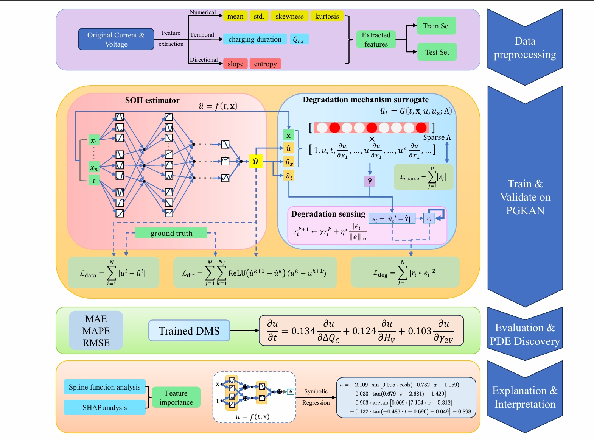
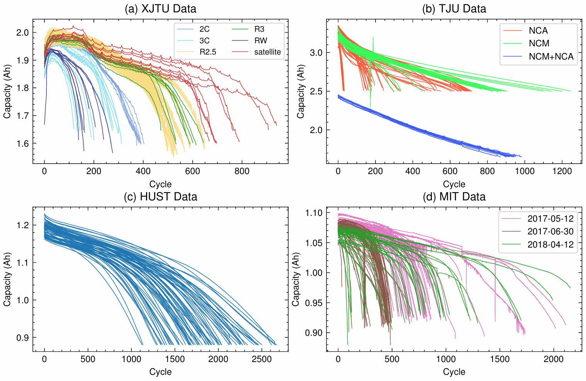

# Interpretable Physics-Guided Neural Networks for State of Health Estimation of Lithium-ion Battery

This repo contains the code and data from our paper published in Journal of Energy Storage.

Website: https://www.sciencedirect.com/science/article/pii/S2352152X26044324

## Contents

- [1. Abstract](#1-abstract)
- [2. Architecture](#2-architecture)
- [3. Environment](#3-environment)
- [4. Datasets](#4-datasets)
  - [4.1. Dataset overview](#41-dataset-overview)
- [5. Training](#5-training)
  - [5.1. PGKAN with PDE discovery](#51-pgkan-with-pde-discovery)
  - [5.2. Baseline comparison](#52-baseline-comparison)
- [6. Interpretability and symbolic regression](#6-interpretability-and-symbolic-regression)
  - [6.1. SHAP and spline feature importance](#61-shap-and-spline-feature-importance)
  - [6.2. Symbolic regression evaluation](#62-symbolic-regression-evaluation)
- [7. Citation](#7-citation)

## 1. Abstract

Accurate prediction of lithium-ion battery state of health (SOH) is essential for safe and reliable operation. Although model-based and data-driven methods have achieved significant progress, their lack of decision transparency leads to limited reliability and poor interpretability in industrial applications. To address this key challenge, we propose a novel SOH estimation method based on a Physics-Guided Kolmogorov-Arnold Network (PGKAN). This dual-module coevolutionary architecture integrates an SOH Estimator (SOHE) and a Degradation Mechanism Surrogate (DMS) to co-evolve SOH estimation and degradation mechanism discovery. Specifically, the SOHE leverages Kolmogorov-Arnold networks (KANs) for high-accuracy and interpretable predictions, while the DMS uncovers hidden degradation patterns and introduces physics-based constraints through an adaptive partial differential equation (PDE) formulation. Experiments on four public datasets encompassing 387 batteries show that PGKAN achieves superior accuracy, reducing the mean absolute percentage error by 8.5% to 19.7% compared to existing methods. More importantly, the DMS successfully reveals the dominant degradation partial differential equations (PDEs) governing each dataset. We further leverage the intrinsic interpretability of the architecture: spline-based analysis yields data-driven feature importance rankings that strongly align with the key terms in the discovered PDEs, and symbolic regression applied to each activation function derives an explicit, symbolic degradation expression. 

## 2. Architecture

The overall PGKAN architecture and training workflow are shown in the figure below.



## 3. Environment

Install dependencies from the project root:

```bash
pip install -r requirements.txt
```

If the PyTorch CUDA build in `requirements.txt` is not compatible with your system, install a suitable PyTorch build.

## 4. Datasets

Place the dataset files in the corresponding folders:

```text
data/
  XJTU data/
  TJU data/
  HUST data/
  MIT data/
```

If your data is stored elsewhere, update the dataset paths in the relevant scripts.

The datasets are openly accessible:

- XJTU: [Zenodo](https://doi.org/10.5281/zenodo.10963339)
- TJU: [Zenodo](https://zenodo.org/record/6405084)
- HUST: [Mendeley Data](https://data.mendeley.com/datasets/nsc7hnsg4s/2)
- MIT: [Materials Data Facility](https://data.matr.io/1/projects/5c48dd2bc625d700019f3204)

### 4.1. Dataset overview



The figure shows capacity degradation curves for XJTU, TJU, HUST, and MIT.

## 5. Training

### 5.1. PGKAN with PDE discovery

Select the dataset and number of runs:

```bash
python train_pgkan_pde.py --dataset XJTU --experiments 1
```

`--dataset` accepts `XJTU`, `TJU`, `HUST`, or `MIT`. Place data in the matching `data/` folder, or update its path in `train_pgkan_pde.py`. Outputs are saved under `results/`.

### 5.2. Baseline comparison

Choose a model with `--model`:

```bash
python train_baseline_comparison.py --model KAN --dataset XJTU
```

Set `--model` to `KAN`, `MLP`, `CNN`, `LSTM`, or `GRU`; `--dataset` accepts `XJTU`, `TJU`, `HUST`, or `MIT`.

## 6. Interpretability and symbolic regression

### 6.1. SHAP and spline feature importance

Set the dataset and the result folder containing the experiment subfolders:

```bash
python feature_importance_analysis.py --dataset XJTU --root "results/path-to-experiment-root" --showplt
```

Pass the result folder with `--root`. Plots are not displayed unless `--showplt` is specified. If the dataset files are outside `data/`, update `BASE_DIR` in `feature_importance_analysis.py`.

### 6.2. Symbolic regression

This symbolic-regression script is separate from PGKAN PDE training: it currently accepts a two-input KAN checkpoint from a baseline-comparison experiment, not the 17-input PGKAN checkpoint. Set `--experiment-dir` to the folder containing its `model.pth`; the JSON is saved there by default:

```bash
python Symbolic.py --experiment-dir "results/path-to-HUST-KAN/Experiment1"
```

Evaluate the generated JSON on the HUST test split:

```bash
python symbolic_regression_evaluation.py --json "results/path-to-HUST-KAN/Experiment1/encoder_symbolic_results.json"
```

If needed, pass `--data-root` to set the HUST data folder. `Symbolic.py` optionally reads `encoder_symbolic_input_ranges.json` from the experiment folder; without it, fitting uses the default input range.


## 7. Citation

If you find our work useful in your research, please consider citing:

```bibtex
@article{ZHAO2026124768,
  title = {Interpretable physics-guided neural networks for state of health estimation of lithium-ion battery},
  journal = {Journal of Energy Storage},
  volume = {182},
  pages = {124768},
  year = {2026},
  issn = {2352-152X},
  doi = {https://doi.org/10.1016/j.est.2026.124768},
  url = {https://www.sciencedirect.com/science/article/pii/S2352152X26044324},
  author = {Hongwei Zhao and Bo Peng and Lei Liu and Jie Huang and Long Zhao and Bin Li},
}
```
If you have any problems, contact me via liulei13@ustc.edu.cn.